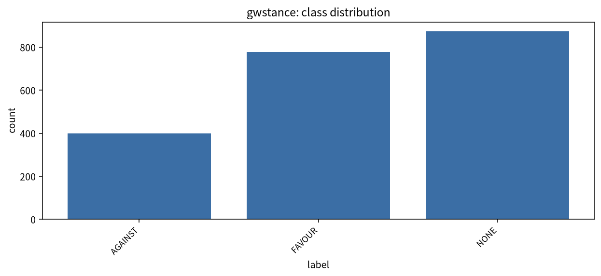
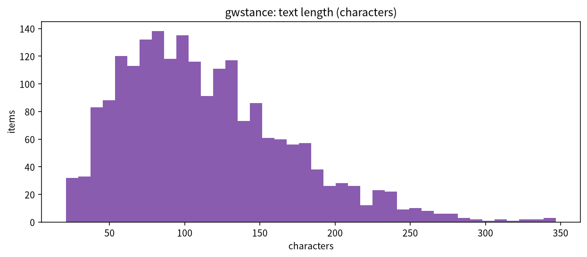
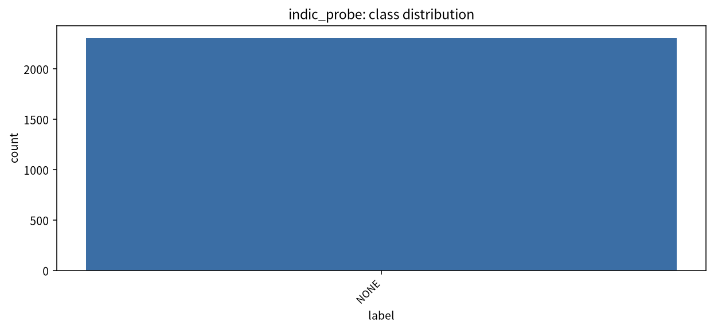
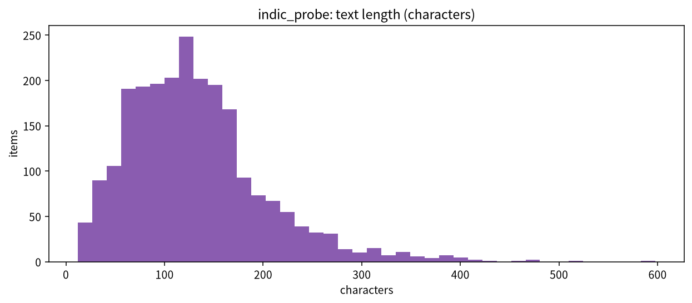

# Linguistic Analysis — Phase 5

Generated by `python -m src.evaluation.eda`. Figures are written under `assets/figures/`.

**Custom corpus: 0 human-verified rows.** `data/raw/custom_climate_dataset/corpus.jsonl` does not exist yet, so no Hindi/Bengali stance statistics can be reported. Every number below comes from the English development corpus and is labelled as such.

## gwstance

- items: **2050** · labels: {'FAVOUR': 777, 'NONE': 873, 'AGAINST': 400}
- scripts: {'Latin': 2050}
- languages: {'English': 2050}
- length: mean 114.3 / median 104 / max 347 characters
- tokens: mean 21.61 / p95 42
- phenomena present: negation 1076 · climate lexicon 1693 · hedging 5 · Romanised(heuristic) 1 · emoji 0
- per-language label mix: {'English': {'FAVOUR': 777, 'NONE': 873, 'AGAINST': 400}}

Top tokens (function words removed): `the`(1963), `of`(1211), `to`(1207), `and`(869), `is`(812), `in`(694), `warming`(669), `global`(664), `climate`(559), `The`(452), `that`(402), `are`(384), `change`(381), `carbon`(338), `on`(290)

## indic_probe

- items: **2312** · labels: {'NONE': 2312}
- scripts: {'Devanagari': 1155, 'Mixed': 1, 'Bengali': 1156}
- languages: {'Hindi': 1156, 'Bengali': 1156}
- length: mean 131.4 / median 122 / max 598 characters
- tokens: mean 26.24 / p95 54
- phenomena present: negation 1221 · climate lexicon 59 · hedging 8 · Romanised(heuristic) 0 · emoji 0
- per-language label mix: {'Hindi': {'NONE': 1156}, 'Bengali': {'NONE': 1156}}

Top tokens (function words removed): `के`(1242), `है।`(1117), `और`(1037), `है`(903), `এবং`(883), `में`(646), `से`(547), `की`(546), `यह`(518), `नहीं`(493), `को`(471), `এটি`(436), `लिए`(433), `করে`(426), `एक`(382)

## Preprocessing A/B (token-level)

**gwstance (English, Latin script)**

| variant | tokens | tokens/item | negation items kept | char retention |
|---|---|---|---|---|
| minimal | 44,298 | 21.61 | 1085 | 1.0 |
| enhanced | 44,298 | 21.61 | 1085 | 1.0 |

**IndicSentiment hi+bn (Devanagari + Bengali script)**

| variant | tokens | tokens/item | negation items kept | char retention |
|---|---|---|---|---|
| minimal | 60,658 | 26.24 | 1221 | 1.0074 |
| enhanced | 60,636 | 26.23 | 1221 | 1.0074 |

> Both variants retain every negation-bearing item on every corpus — the invariant the tests assert.
> Where the two rows are identical it is because the corpus carries no emoji, zero-width joiners or URLs:
> `enhanced` only differs from `minimal` on those surface phenomena, so a measurable A/B gap requires the
> noisy social-media corpus, not edited news sentences. The macro-F1 comparison is run in Phase 7b once
> the custom corpus exists; the token-level contract above is what can be verified now.

